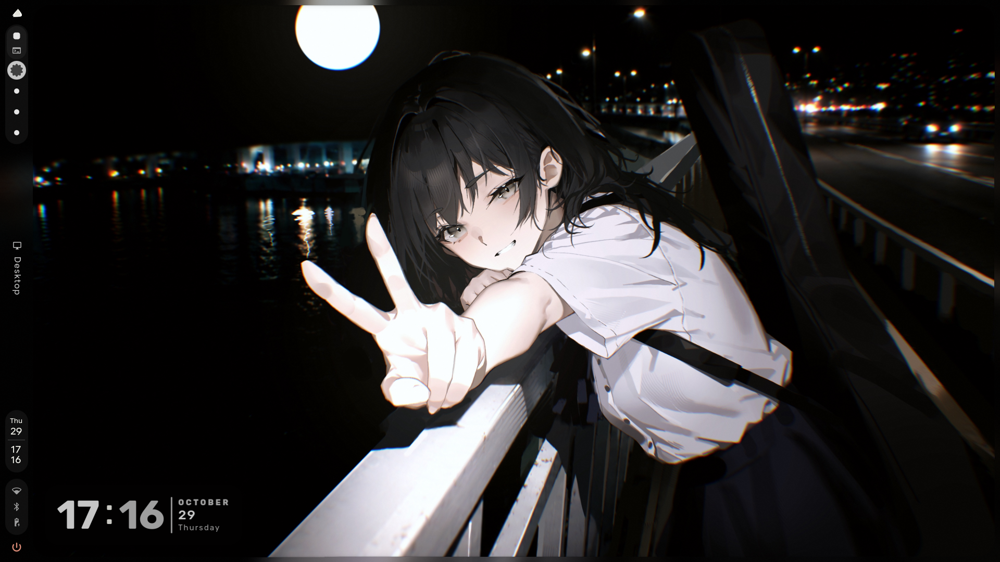
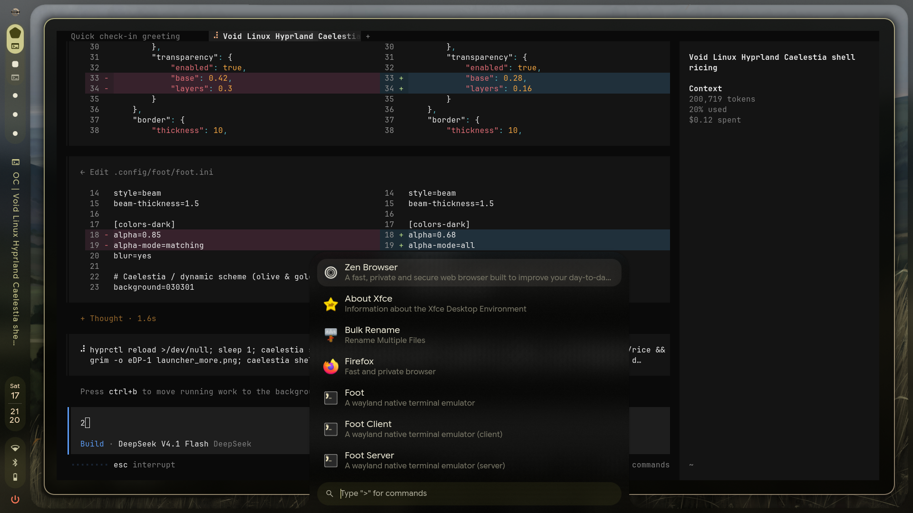
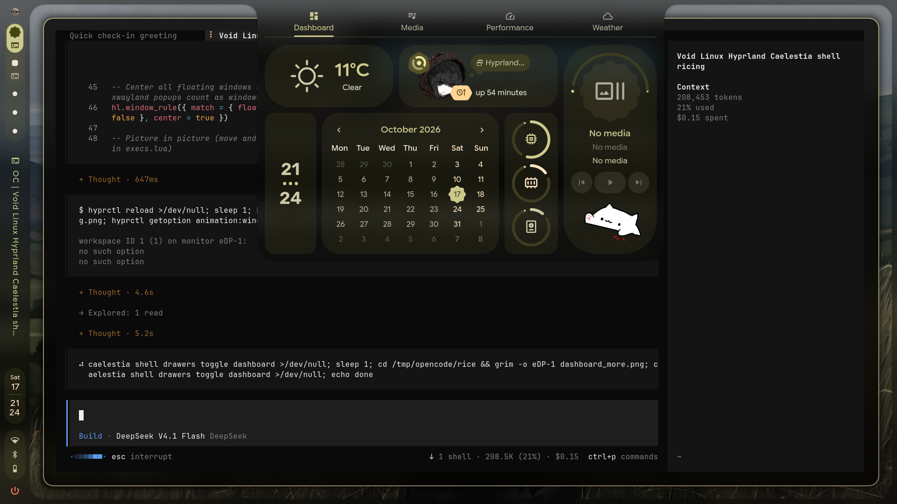
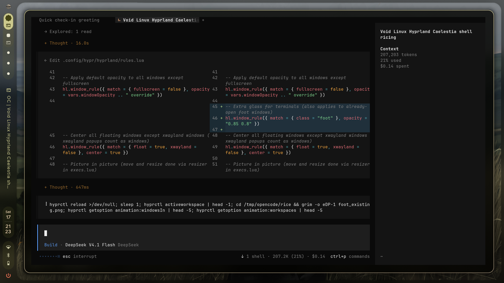
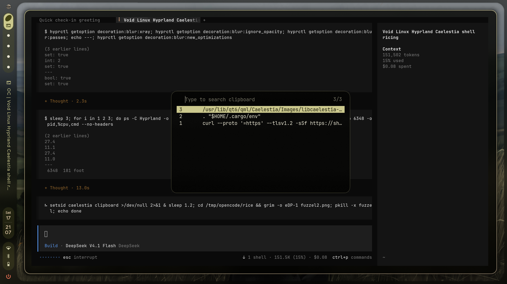

# caelestia-rice

Kiyra's Void Linux → Artix rice: **Caelestia shell + Hyprland (Lua config)** with
a heavy frosted-glass look over the olive-gold dynamic scheme derived from the
wallpaper.



## The look

| What | Where | Value |
| --- | --- | --- |
| Shell transparency | `configs/caelestia/shell.json` | `base 0.28`, `layers 0.16` — launcher, dashboard, sidebar, OSD are all see-through glass |
| Shell blur over windows | `configs/hypr/variables.lua` | `blurXray = false`, size 10, passes 2 — panels frost whatever is behind them |
| Glass terminal | `configs/foot/foot.ini` | `alpha 0.68`, `alpha-mode all`, `blur yes` + Hyprland rule `opacity = "0.85 0.8"` for class `foot` |
| Launcher (fuzzel) | `configs/fuzzel/fuzzel.ini` | centered glass background, solid gold selection |
| Borders | `configs/hypr/variables.lua` | 2px gradient (gold → cream), 20px rounding, deep shadows, gaps 8/16/28 |
| Cursor | `install.sh` | [Bibata-Modern-Ice](https://github.com/ful1e5/Bibata_Cursor) v2.0.7, size 24 |
| Scheme | `configs/hypr/scheme/` + installer | `dynamic` / `hard` / `tonalspot` / dark, olive-gold palette |
| Shell extras | `configs/caelestia/shell.json` | desktop clock (glass), wallpaper lock screen, bigger launcher items |
| Column bar / animations | `configs/caelestia/shell-tokens.json`, `configs/hypr/hyprland/animations.lua` | narrow 44px glass rail; stock Hyprland animations |






## What's in the box

```
configs/
├── bash/.bashrc              starship, direnv, zoxide, eza, ble.sh, caelestia greeting + fastfetch
├── caelestia/                Caelestia shell + Hyprland user config
│   ├── shell.json            transparency, border/corner, bar entries, clock, lock screen
│   ├── shell-tokens.json     bar width, launcher item sizes
│   ├── hypr-vars.lua         editor/browser/file manager/cursor settings
│   ├── hypr-user.lua         per-session services
│   └── monitors/eDP-1/       per-monitor shell settings
├── fastfetch/config.jsonc    the fetch shown in the terminal greeting
├── foot/foot.ini             glassy terminal
├── fuzzel/fuzzel.ini         app launcher / search
├── hypr/                     full Hyprland Lua config (blur, shadows, gaps, borders, rules, binds)
└── starship/starship.toml    the prompt
bin/          caelestia-session-services (pipewire stack for the session)
wallpapers/   wallhaven-qrgqyq.jpg
install.sh    the installer
```

## Installing on a fresh Artix/Arch system

```sh
git clone git@github.com:etokiyra/caelestia-rice.git
cd caelestia-rice

# 1. Requirements (guided pacman/AUR install)
./install.sh --packages

# 2. Apply the rice
./install.sh

# 3. Log out → pick the Caelestia session (or, in an existing Hyprland session):
hyprctl reload
```

`./install.sh` backs everything it touches up to `~/.config-backup-rice-<timestamp>`,
copies the configs, installs the wallpaper, pins the scheme
(`caelestia scheme set -n dynamic -f hard -m dark -v tonalspot`) and re-applies
the wallpaper so the colours regenerate exactly like on the source machine.
Use `--dry-run` to preview the steps first.

### Manual package list (`--packages`)

Repo packages:

> hyprland xdg-desktop-portal-hyprland xdg-desktop-portal-gtk foot fuzzel fastfetch
> starship grim slurp swappy wl-clipboard cliphist trash-cli polkit-gnome
> gnome-keyring gammastep geoclue bluez-utils networkmanager brightnessctl ddcutil
> libcava libqalculate power-profiles-daemon dart-sass ttf-jetbrains-mono-nerd
> ttf-material-symbols-variable ttf-rubik-vf ttf-cascadia-code-nerd
> papirus-icon-theme dolphin eza zoxide direnv lazygit

AUR packages (paru/yay):

> caelestia-cli caelestia-shell quickshell-git qt6-m3shapes-git qtengine gpu-screen-recorder

`./install.sh` also enables `power-profiles-daemon` in systemd/dinit when it
finds it. The Caelestia battery panel needs that daemon; on non-systemd
installs D-Bus activation alone will not start it.

### Login manager (Artix/dinit: greetd + tuigreet)

The repo ships the greetd config used on the source machine
(`configs/greetd/config.toml`): tuigreet with clock and remembered username,
launching `start-hyprland` on **VT 7**. VT 7 matters: Artix runs gettys on
tty1–tty6, and a greetd on VT 1 will fight `agetty` for the terminal.

```sh
sudo ./setup-greetd.sh          # or: --dry-run first
sudo reboot
```

The script removes `lightdm-dinit` explicitly, installs
`greetd greetd-tuigreet greetd-dinit`, writes `/etc/greetd/config.toml` with
the chosen VT (`--vt N`, default 7) and enables the `greetd` dinit service.
It never starts greetd inside the running session, so nothing fights over the
current VT. Rollback from a TTY:

```sh
sudo dinitctl disable greetd
sudo pacman -S --needed lightdm-dinit
sudo dinitctl enable lightdm
sudo reboot
```

If you must use a VT below 7, remove that VT from `ACTIVE_CONSOLES` in
`/etc/dinit.d/config/console.conf` first.

### Networking (Artix/dinit: ConnMan → NetworkManager)

`networkmanager-dinit` provides the `NetworkManager` service (capital N).
Install it **before** stopping ConnMan, otherwise pacman cannot download it:

```sh
sudo pacman -S --needed networkmanager-dinit   # while still online
sudo dinitctl disable connmand && sudo dinitctl stop connmand
sudo dinitctl enable NetworkManager && sudo dinitctl start NetworkManager
nmtui   # or: nmcli device wifi connect "SSID" password "…"
```

Or run `sudo ./setup-network.sh`, which does the same checks in the right
order and is a no-op once NetworkManager is already active.

ConnMan's saved Wi-Fi profiles are not imported (they live root-only in
`/var/lib/connman`); reconnect once and NM stores the keyring entry.

Everything else (terminal fonts/icons, pipewire session, portals) comes with
`caelestia install` if you prefer the official base first — in that case run
it **before** `./install.sh` so the riced files win.

## Notes

- **Hyprland Lua config** is native since Hyprland 0.55 — any current `hyprland`
  build works (tested on 0.56.2).
- `configs/hypr/hyprland/execs.lua` expects Arch-style paths
  (`/usr/lib/polkit-gnome/...`, `/usr/lib/geoclue-2.0/demos/agent`) — on
  non-Arch distros adjust those two lines.
- `configs/caelestia/monitors/eDP-1/shell.json` is keyed to the laptop panel
  `eDP-1`; on different hardware, rename or drop that folder.
- The browser line (`hypr-vars.lua`) uses the **Zen flatpak**
  (`flatpak install app.zen_browser.zen`); change it if you use something else.
- Optional niceties used by `.bashrc` are guarded: ble.sh
  (`~/.local/share/blesh/ble.sh`), cargo, deno — install them if you want them.
- To re-generate/refresh the scheme after a wallpaper change:
  `caelestia wallpaper -f ~/Pictures/Wallpapers/wallhaven-qrgqyq.jpg`

## Tweaking knobs

- Shell glass strength: `configs/caelestia/shell.json` → `appearance.transparency.base` / `.layers`
- Terminal glass: `configs/foot/foot.ini` → `alpha` / `alpha-mode`
- Blur cost vs. looks: `configs/hypr/variables.lua` → `blurXray`, `blurPasses`, `blurSize`
- Border gradient/rounding: `configs/hypr/variables.lua` → `activeWindowBorderColour` / `windowRoundingPower`
- Per-app exceptions: `configs/hypr/hyprland/rules.lua`

## Credits

- [Caelestia dotfiles](https://github.com/caelestia-dots/caelestia) — the base dots & shell
- [Hyprland](https://github.com/hyprwm/Hyprland) — compositor (Lua config)
- [Bibata cursor](https://github.com/ful1e5/Bibata_Cursor) by ful1e5
- Wallpaper from wallhaven (`qrgqyq`)
